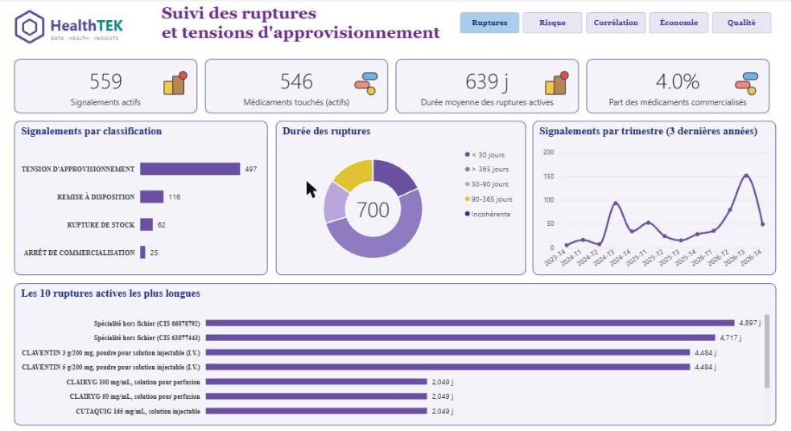
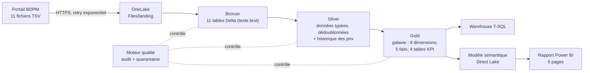
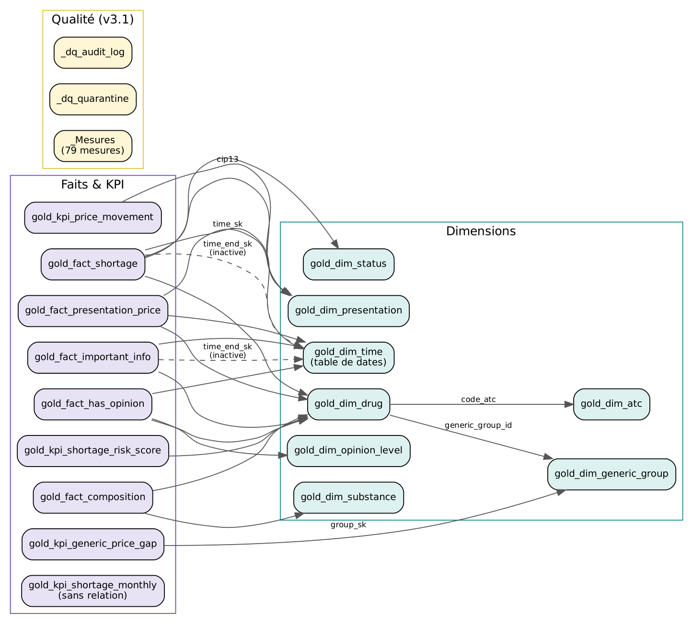
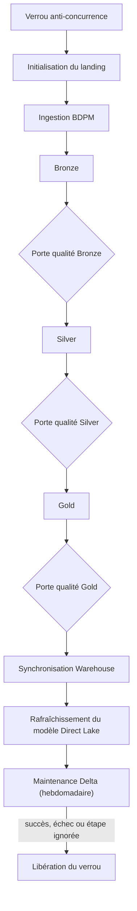
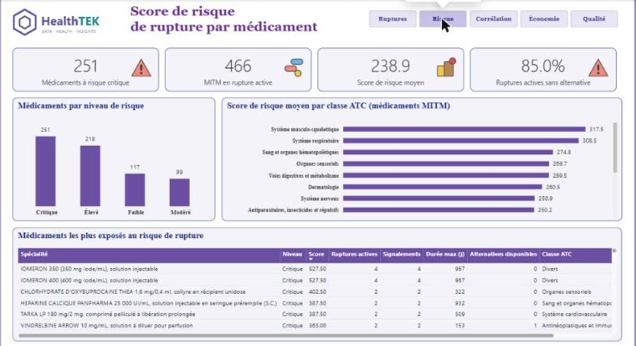
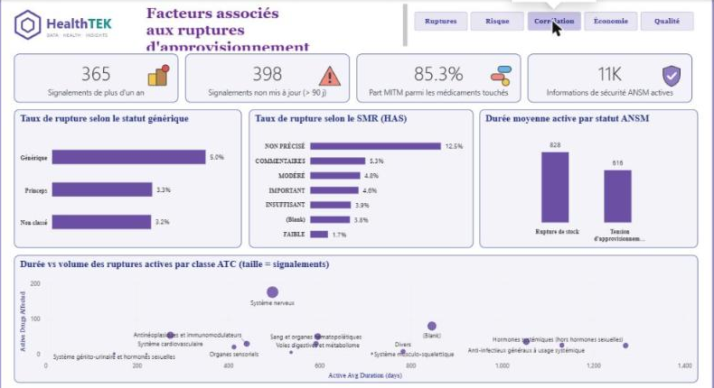
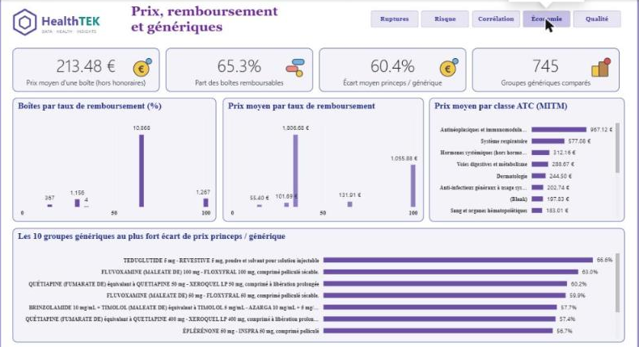
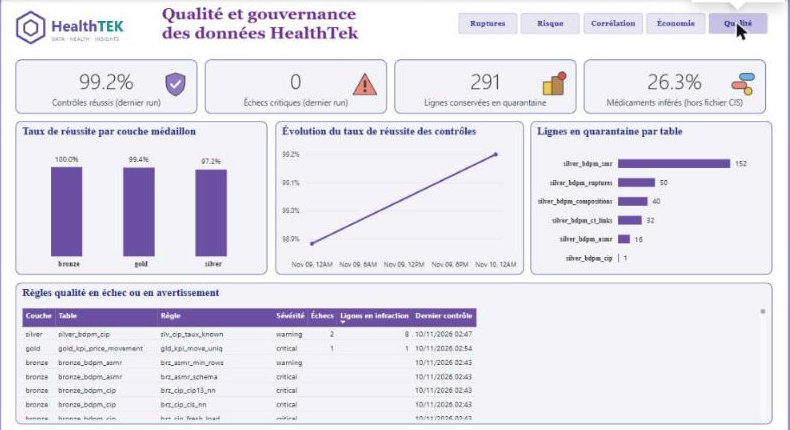

# HealthTek — Plateforme analytique des ruptures de médicaments sur Microsoft Fabric

Plateforme de données de bout en bout qui ingère chaque jour les fichiers publics de la **Base de Données Publique des Médicaments (BDPM)** pour suivre et anticiper les **ruptures et tensions d'approvisionnement** de médicaments en France. Les données sont chargées en architecture Medallion sur Microsoft Fabric, contrôlées par un moteur de qualité, puis restituées dans un rapport Power BI en mode Direct Lake.




---

## Sommaire

1. [Contexte et objectifs](#contexte-et-objectifs)
2. [Architecture](#architecture)
3. [Sources de données](#sources-de-données)
4. [Couches Bronze, Silver et Gold](#couches-bronze-silver-et-gold)
5. [Qualité des données](#qualité-des-données)
6. [Orchestration](#orchestration)
7. [Modèle sémantique et rapport Power BI](#modèle-sémantique-et-rapport-power-bi)
8. [Organisation du dépôt](#organisation-du-dépôt)
9. [Déploiement](#déploiement)
10. [Choix techniques](#choix-techniques)

---

## Contexte et objectifs

L'ANSM publie la liste des signalements de ruptures et de tensions d'approvisionnement, et la BDPM décrit l'ensemble des spécialités commercialisées en France : présentations, prix, compositions, groupes génériques, avis de la HAS, médicaments d'intérêt thérapeutique majeur (MITM).

Le projet répond à quatre questions :

- **Combien** de médicaments sont en rupture aujourd'hui, de quel type, et depuis combien de temps ?
- **Lesquels** sont les plus exposés, et existe-t-il une alternative commercialisée dans leur groupe générique ?
- **Quels facteurs** sont associés aux ruptures : statut générique, niveau de SMR, classe thérapeutique ATC ?
- **Peut-on faire confiance** aux chiffres du jour ?

---

## Architecture



| Composant Fabric | Nom | Rôle |
| :--- | :--- | :--- |
| Lakehouse | `lh_health_analytics` | Fichiers déposés (landing) et tables Delta des trois couches |
| Environment | `env_health_analytics` | Runtime Spark et configuration partagés par les notebooks |
| Notebooks | 14 notebooks PySpark | Utilitaires partagés, ingestion, transformations, qualité, exploitation |
| Data pipeline | `pl_master_health_pipeline` | Orchestration quotidienne de bout en bout |
| Warehouse | `wh_health_analytics` | Copie T-SQL des tables Gold pour les usages SQL |
| Semantic model | `sem_health_analytics` | Modèle Direct Lake, 79 mesures DAX |
| Report | `rpt_healthtek_executive` | Rapport de pilotage, 5 pages |

---

## Sources de données

Les 11 fichiers sont téléchargés depuis le portail officiel de la BDPM, chacun selon sa propre cadence de mise à jour.

| Fichier | Contenu | Cadence | Critique |
| :--- | :--- | :--- | :---: |
| `CIS_bdpm.txt` | Spécialités pharmaceutiques | Mensuelle | Oui |
| `CIS_CIP_bdpm.txt` | Présentations, prix et remboursement (CIP13) | Quotidienne | Oui |
| `CIS_CIP_Dispo_Spec.txt` | Ruptures et tensions d'approvisionnement (ANSM) | Bimensuelle | Oui |
| `CIS_COMPO_bdpm.txt` | Compositions et substances actives | Mensuelle | |
| `CIS_HAS_SMR_bdpm.txt` | Avis HAS : service médical rendu | Mensuelle | |
| `CIS_HAS_ASMR_bdpm.txt` | Avis HAS : amélioration du SMR | Mensuelle | |
| `HAS_LiensPageCT_bdpm.txt` | Liens vers les avis de la commission de la transparence | Mensuelle | |
| `CIS_GENER_bdpm.txt` | Groupes génériques | Mensuelle | |
| `CIS_CPD_bdpm.txt` | Conditions de prescription et de délivrance | Mensuelle | |
| `CIS_MITM.txt` | Médicaments d'intérêt thérapeutique majeur et classe ATC | Mensuelle | |
| `CIS_InfoImportantes.txt` | Informations de sécurité de l'ANSM | Quotidienne | |

En mode `auto`, le pipeline ne télécharge que les sources dont l'intervalle de mise à jour est échu. Chaque dépôt est horodaté, validé (taille, HTML d'erreur, nombre de colonnes, encodage), converti en UTF-8, puis écrit de façon atomique avec un manifeste JSON.

---

## Couches Bronze, Silver et Gold

**Bronze** — le dernier dépôt de chaque source est chargé tel quel, en texte, avec un schéma positionnel explicite et cinq colonnes d'audit : date d'ingestion, fichier source, système source, identifiant du run et date de l'instantané.

**Silver** — chaque source est nettoyée et typée de façon déterministe : dates multi-formats, montants au format français, validation de la clé EAN-13 des codes CIP13, normalisation des libellés, rangs ordinaux des avis SMR et ASMR, extraction des liens des informations de sécurité. Aucune ligne n'est supprimée en silence : les lignes invalides et les doublons écartés sont conservés dans `_dq_quarantine` avec le motif du rejet. L'historique des prix est conservé jour après jour dans `silver_bdpm_cip_history`.

**Gold** — un modèle en galaxie, construit avec des clés de substitution déterministes (`xxhash64`) :

| Type | Tables |
| :--- | :--- |
| Dimensions (8) | médicament, présentation, groupe générique, substance, classe ATC, statut ANSM, niveau d'avis HAS, calendrier |
| Faits (5) | prix et remboursement, ruptures, avis HAS, informations de sécurité, composition |
| KPI (4) | score de risque de rupture, écart de prix princeps / générique, variation des prix, signalements mensuels |

Les codes présents dans un fichier mais absents du référentiel des spécialités deviennent des **membres inférés**, et chaque dimension possède un membre « inconnu » (`-1`). Le rapport ne perd ainsi aucune ligne de fait.

Le **score de risque de rupture** combine le nombre et la durée des ruptures, les ruptures en cours, leur récence, le statut MITM et l'absence d'alternative commercialisée dans le groupe générique.



---

## Qualité des données

Le moteur `nb_util_validation` évalue en une passe Spark par table un catalogue de règles déclaratives : non-nullité, unicité, plages de valeurs, expressions régulières, intégrité référentielle, fraîcheur, réconciliation entre couches, continuité du calendrier.

- Chaque contrôle est historisé dans `_dq_audit_log` : règle, couche, sévérité, lignes en infraction, run.
- Une **porte qualité** après chaque couche bloque le pipeline si une règle critique échoue.
- La page « Qualité » du rapport affiche le taux de réussite du dernier run, les échecs critiques, la quarantaine et la part de membres inférés.

---

## Orchestration

Le pipeline `pl_master_health_pipeline` enchaîne 13 étapes. Chacune possède sa propre branche d'alerte et d'échec, avec le message d'erreur réel de l'activité.



| Principe | Mise en œuvre |
| :--- | :--- |
| Pas d'exécutions concurrentes | `concurrency = 1` et verrou coopératif dans une table Delta, avec expiration |
| Verrou toujours libéré | La dernière étape dépend de la précédente en `Succeeded`, `Failed` **et** `Skipped` |
| Rejeu d'une date | Paramètre `p_run_date` : toutes les étapes sont idempotentes |
| Publication cohérente | Le modèle Direct Lake est recadré une seule fois, **après** la porte qualité Gold |
| Reprises ciblées | Plusieurs tentatives sur l'ingestion réseau, une sur les étapes Spark idempotentes, aucune sur les portes qualité |
| Observabilité | Module `logging` (horodatage, niveau, origine) et sortie JSON de chaque notebook lue par le pipeline |

Paramètres : `p_source_filter`, `p_fail_fast`, `p_skip_warehouse`, `p_run_date`, `p_gold_mode`, `p_run_maintenance`, `p_vacuum_retain_hours`.

---

## Modèle sémantique et rapport Power BI

Le modèle `sem_health_analytics` lit directement les tables Delta en mode **Direct Lake** : performances d'un modèle importé, sans copie de données. Ses 79 mesures DAX utilisent systématiquement `DIVIDE`, recalculent les ratios au lieu de faire des moyennes de taux, et départagent les « Top 10 » avec `ROWNUMBER`.

| Page | Contenu |
| :--- | :--- |
| Ruptures | Signalements actifs, médicaments touchés, durée moyenne, répartition par classification et par durée, évolution trimestrielle, ruptures actives les plus longues |
| Risque | Médicaments à risque critique, MITM en rupture, absence d'alternative, score moyen par classe ATC |
| Corrélation | Taux de rupture selon le statut générique, le SMR et le statut ANSM ; durée et volume par classe ATC |
| Économie | Prix moyen, part des boîtes remboursables, écart de prix princeps / générique |
| Qualité | Réussite des contrôles, échecs critiques, quarantaine, membres inférés |

| | |
| :---: | :---: |
|  |  |
|  |  |

---

## Organisation du dépôt

```text
fabric/                          Items Microsoft Fabric (format Git integration)
├── notebooks/
│   ├── utilities/               nb_util_config, nb_util_io, nb_util_logging, nb_util_validation
│   ├── bronze/                  nb_bronze_ingest_bdpm, nb_bronze_load_bdpm
│   ├── silver/                  nb_silver_clean_bdpm
│   ├── gold/                    nb_gold_build_galaxy
│   ├── quality/                 nb_dq_validate_layer
│   ├── warehouse/               nb_warehouse_sync_gold
│   └── ops/                     nb_ops_setup_folders, nb_ops_run_guard,
│                                nb_ops_maintenance_delta, nb_ops_refresh_semantic_model
├── pl_master_health_pipeline.DataPipeline/
├── sem_health_analytics.SemanticModel/
└── rpt_healthtek_executive.Report/
docs/
└── images/                      Captures du rapport et schémas
```

---

## Déploiement

1. Créer un Workspace Fabric sur une capacité F2 ou supérieure (ou une capacité d'essai).
2. Connecter le Workspace à ce dépôt (**Workspace settings → Git integration → GitHub**), dossier `fabric/`, puis **Update all**. Le Lakehouse, l'Environment, les notebooks, le pipeline, le modèle sémantique et le rapport sont créés.
3. Attacher `lh_health_analytics` comme Lakehouse par défaut des notebooks, si Fabric ne l'a pas fait automatiquement.
4. Lancer `pl_master_health_pipeline` avec `p_source_filter = all` pour le premier chargement.
5. Dans les paramètres de `sem_health_analytics`, désactiver **Keep your Direct Lake data up to date** : c'est le pipeline qui publie les données, après validation.
6. Planifier le pipeline (par exemple tous les jours à 2 h).

---

## Choix techniques

- **Lakehouse et Delta Lake** pour les trois couches : transactions ACID, `MERGE` idempotent, `replaceWhere` par instantané, time travel.
- **Notebooks utilitaires chargés par `%run`** : une seule source de vérité pour la configuration, les accès aux tables et la journalisation, sans packaging de bibliothèque.
- **Clés de substitution déterministes** : les clés restent identiques d'un run à l'autre, ce qui rend les rechargements reproductibles.
- **Direct Lake** plutôt qu'Import : pas de copie des données, recadrage en quelques secondes après chaque chargement.
- **Warehouse T-SQL** alimenté depuis Gold pour les usages SQL, avec contrôles d'intégrité après chargement (orphelins, doublons).

---

## Auteur

**Gane Kwada Amala** — Data Engineer
[LinkedIn](https://www.linkedin.com/in/gane-kwada-amala) · Données : [BDPM](https://base-donnees-publique.medicaments.gouv.fr/), ANSM, HAS (licence ouverte).
